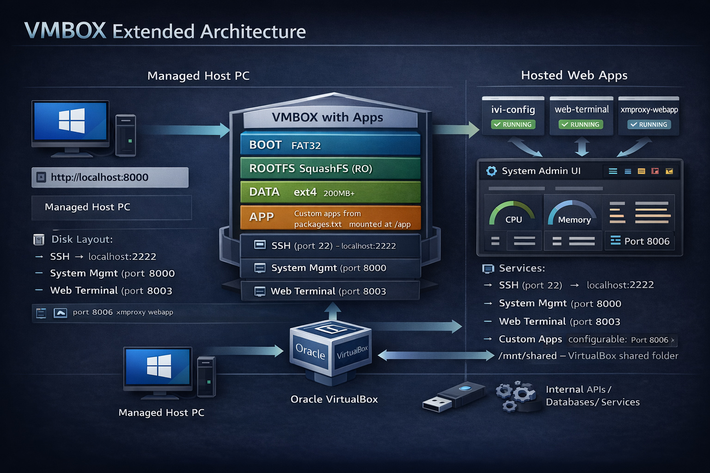

# VMBOX - VirtualBox-based Web Application Hosting Framework

A flexible build system for generating minimal Alpine Linux-based VirtualBox images. VMBOX can be deployed as a **base reference framework** or extended with **custom applications** packaged into a separate APP partition.



## Overview

VMBOX provides:
- **Immutable Root Filesystem**: SquashFS-based read-only rootfs with OverlayFS for runtime changes
- **Persistent Data**: Separate ext4 partition for user data, configurations, and overlay changes
- **Optional APP Partition**: SquashFS partition for deploying custom web apps and services
- **Factory Reset**: One-click reset to restore the system to its original state
- **System Management WebUI**: Real-time dashboard with CPU, memory, disk, network stats, and log viewer
- **Cross-Platform**: Export as OVA for use on Windows, macOS, or Linux
- **Minimal Footprint**: Based on Alpine Linux (~150MB compressed)

## Architecture

### Base Configuration (3-Partition)

Use this for a minimal reference system or when apps are bundled in rootfs:

```
┌─────────────────────────────────────────────────────────────────┐
│                           VMBOX (Base)                          │
├─────────────────────────────────────────────────────────────────┤
│  Disk Layout (MBR/BIOS)                                         │
│  ┌──────────┬────────────────────┬─────────────────────────┐    │
│  │ BOOT     │ ROOTFS             │ DATA                    │    │
│  │ (FAT32)  │ (SquashFS, ro)     │ (ext4, rw)              │    │
│  │ 64MB     │ 500MB              │ 200MB+                  │    │
│  │ syslinux │ Alpine + services  │ overlay, /var, /home    │    │
│  │ kernel   │                    │                         │    │
│  │ initramfs│                    │                         │    │
│  └──────────┴────────────────────┴─────────────────────────┘    │
│                                                                 │
│  Services:                                                      │
│  ├── SSH (port 22)           → localhost:2222                   │
│  └── System Mgmt (port 8000) → localhost:8000                   │
└─────────────────────────────────────────────────────────────────┘
```

### Extended Configuration (4-Partition with APP)

Use this for deploying custom web applications and backend services:

```
┌─────────────────────────────────────────────────────────────────────────┐
│                           VMBOX (with Apps)                             │
├─────────────────────────────────────────────────────────────────────────┤
│  Disk Layout (MBR/BIOS)                                                 │
│  ┌──────────┬──────────────┬──────────────┬────────────────────────┐    │
│  │ BOOT     │ ROOTFS       │ DATA         │ APP                    │    │
│  │ (FAT32)  │ (SquashFS)   │ (ext4, rw)   │ (SquashFS, ro)         │    │
│  │ 64MB     │ 500MB        │ 200MB        │ 200MB+                 │    │
│  │ syslinux │ Alpine +     │ overlay,     │ Custom apps from       │    │
│  │ kernel   │ base services│ /var, /home  │ packages.txt           │    │
│  │ initramfs│              │ app-data     │ mounted at /app        │    │
│  └──────────┴──────────────┴──────────────┴────────────────────────┘    │
│                                                                         │
│  Runtime Filesystem:                                                    │
│  /           → merged (squashfs lower + data/overlay upper)             │
│  /data       → DATA partition (direct mount)                            │
│  /app        → APP partition (read-only, custom applications)           │
│  /mnt/shared → VirtualBox shared folder                                 │
│                                                                         │
│  Services:                                                              │
│  ├── SSH (port 22)             → localhost:2222                         │
│  ├── System Mgmt (port 8000)   → localhost:8000                         │
│  ├── Web Terminal (port 8003)  → localhost:8003  [from APP partition]   │
│  └── Custom Apps (configurable)→ localhost:XXXX  [from APP partition]   │
└─────────────────────────────────────────────────────────────────────────┘
```

## Prerequisites

### Host System (Linux)

```bash
# Arch Linux
sudo pacman -S parted dosfstools e2fsprogs squashfs-tools syslinux virtualbox wget mtools socat jq

# Ubuntu/Debian
sudo apt install parted dosfstools e2fsprogs squashfs-tools syslinux virtualbox wget mtools socat jq
```

## Quick Start: Base Framework

Build a minimal VMBOX without custom applications:

```bash
# Clone the repository
git clone https://github.com/hackboxguy/vmbox.git
cd vmbox

# Build base rootfs
sudo ./build.sh --mode=base --output=/tmp/alpine-build --version=1.0.0

# Create disk image (3-partition: BOOT + ROOTFS + DATA)
sudo ./scripts/03-create-image.sh \
  --rootfs=/tmp/alpine-build/rootfs \
  --output=/tmp/alpine-build \
  --ospart=500M \
  --datapart=200M

# Fix ownership
sudo chown -R $(id -u):$(id -g) /tmp/alpine-build

# Convert to VirtualBox VM
./scripts/04-convert-to-vbox.sh \
  --input=/tmp/alpine-build/alpine-vbox.raw \
  --vmname=vmbox-base \
  --export-ova \
  --force

# Start the VM
VBoxManage startvm vmbox-base --type headless
```

After ~30 seconds, access http://localhost:8000 for the System Management WebUI.

## Extended Build: With Custom Applications

Build VMBOX with custom web applications packaged into the APP partition:

### Step 1: Clone Repository and Prepare Apps

```bash
# Clone VMBOX (with submodules)
git clone --recurse-submodules https://github.com/hackboxguy/vmbox.git
cd vmbox

# Or, if already cloned, initialize submodules:
git submodule update --init --recursive

# Clone additional apps into the apps/ folder as needed
cd apps/
git clone https://github.com/hackboxguy/web-terminal.git
cd ..
```

### Step 2: Configure packages.txt

Edit `packages.txt` to list all apps to be packaged:

```bash
vi packages.txt
```

Example `packages.txt` format:
```
# NAME|GIT_REPO|VERSION|CMAKE_OPTIONS|BUILD_DEPS|PORT|PRIORITY|TYPE|DESCRIPTION
web-terminal|file://./apps/web-terminal|HEAD||cmake|8003|10|webapp|Serial Console Web Terminal
```

### Step 3: Build Base Rootfs

```bash
sudo ./build.sh --mode=base --output=/tmp/alpine-build --version=1.0.1
```

### Step 4: Build APP Partition

```bash
sudo ./scripts/build-app-partition.sh \
  --packages=packages.txt \
  --output=/tmp/alpine-build/app \
  --rootfs=/tmp/alpine-build/rootfs
```

### Step 5: Create Disk Image with APP Partition

```bash
sudo ./scripts/03-create-image.sh \
  --rootfs=/tmp/alpine-build/rootfs \
  --output=/tmp/alpine-build \
  --ospart=500M \
  --datapart=200M \
  --apppart=200M \
  --appdir=/tmp/alpine-build/app/app
```

### Step 6: Fix Ownership

```bash
sudo chown -R $(id -u):$(id -g) /tmp/alpine-build
```

### Step 7: Convert to VirtualBox VM

```bash
./scripts/04-convert-to-vbox.sh \
  --input=/tmp/alpine-build/alpine-vbox.raw \
  --vmname=vmbox-apps \
  --appdir=/tmp/alpine-build/app/app \
  --usb=2 \
  --force
```

### Step 8: Export OVA (for Windows/macOS deployment)

```bash
VBoxManage export "vmbox-apps" -o "vmbox-apps.ova"
```

### Step 9: Start and Test

```bash
# Start VM (headless)
VBoxManage startvm vmbox-apps --type headless

# Wait ~45 seconds for boot, then access:
# - System Management: http://localhost:8000
# - Web Terminal: http://localhost:8003 (or via proxy at http://localhost:8000/app/web-terminal/)
```

## Private Generic Flasher Appliance

The repository includes `build-generic-flasher-tool.sh` for the private RH850
flashing appliance. It builds the System Management UI, Web Terminal, and RH850
Flasher app, then registers and optionally exports an OVA.

The builder keeps firmware and target configuration out of the VMBOX source.
It uses these private sibling source directories, cloning a missing one from
its configured private GitHub origin before it starts the build:

```text
rh850-flash-tools/  sp6bins/  web-terminal/  vmbox/
```

The private RH850 flasher webapp is a pinned VMBOX submodule and is initialized
or synchronized to its pinned revision automatically. Review the actions and
host prerequisites first:

```bash
./build-generic-flasher-tool.sh --dry-run
```

Run it as a normal user:

```bash
./build-generic-flasher-tool.sh --version=1.0.0
```

It adds an exact `0403:a9a0` USB filter for the EEHB Bluebox. Use `--usb=2` or
`--usb=3` only when the host has the matching VirtualBox Extension Pack.

## The two display appliances

Two VirtualBox appliances of the display system-design toolchain are built from this repo. Each has its own OVA,
image version and data partition, and both are reached through the vmbox dashboard.

| | SBD configurator | partkb converter |
|---|---|---|
| build | `build-sbd-configurator-ova.sh --version=<x.y.z>` | `build-partkb-converter-ova.sh --version=<x.y.z>` |
| app | submodule `apps/text-to-block` at the tag in `packages-sbd-configurator.txt` | submodule `apps/partkb` at the tag in `packages-partkb-converter.txt`, with the text-to-block schema / tools / library of `apps/text-to-block` (`-DTEXT_TO_BLOCK_DIR`, staged into the build chroot) |
| runtime packages | `packages-sbd-configurator-system.txt` (python3, Pillow, fonts, resvg) | `packages-partkb-converter-system.txt` (python3, PyMuPDF 1.28.2 wheel pinned by SHA-256, httpx, PyYAML, jsonschema, Pillow, git, sqlite) |
| hostname / dashboard cookie | `sbd-configurator` / `session-sbd-configurator-<version>` | `partkb-converter` / `session-partkb-converter-<version>` |
| host ports (NAT, in the OVA) | dashboard 8000, app 8008, web terminal 8003, SSH 2222 (the stock ports) | dashboard **8010**, web terminal **8013**, SSH **2223** (guest 8000 / 8003 / 22) |
| app port | 8008 (forwarded directly too, for debugging) | 8009 on 127.0.0.1 only: through the dashboard proxy, never forwarded |
| user path | `http://<host>:8000/app/sbd-configurator/` | `http://<host>:8010/app/partkb-converter/` |
| data partition | 1 GB: `/data/app-data/sbd-configurator/` (profiles, parts, price sets, pictures, photos, `library-overlay/`) | 16 GB dynamically allocated VDI: `/data/app-data/partkb-converter/` (store, data repository, working library, packages, jobs) and `/data/app-config/partkb-converter/` (Azure key 0600, settings) |
| moving to a new release | "My data" pack (download on the old VM, load on the new one) | data bundle on the Data tab (download, restore in 64 MB chunks) |

- **Current images (2026-10-26):** configurator `vmbox-sbd-configurator-v0.16.0` (configurator-0.16.0) and converter
  **`vmbox-partkb-converter-v0.3.0`** (partkb-0.7.2: the data bundle's per-file content hashes are checked on
  restore). The converter 0.3.0 is the image for the owner's P5 (partkb `docs/partkb-vm-plan.md` §9). OVAs in
  `/home/adav/extended-disk/vmbox-ova/`.
- **Cookies:** the dashboard's session cookie is `session-<hostname>-<image version>`. Two appliances, or two
  releases of one appliance (the old and the new VM during a move), reached on one host keep separate logins.
- **Proxy limits** come from each app's manifest: `"proxy": {"limits": [{"prefix", "max_body_mb", "timeout_s"}]}`;
  the first matching prefix wins. The default is 1 MB / 30 s, the ceiling 4 GB / 600 s.
  - Configurator: photos and user-data 512 MB / 300 s, library-package 50 MB / 120 s.
  - Converter: documents 200 MB / 300 s, library-package 50 MB / 120 s, bundle chunks 128 MB / 600 s.

  An app API path (`/app/<name>/api/...`) answers 401 JSON with a missing or expired login; pages redirect to
  `/login`.
- **Per-VM settings without a rebuild:** `/data/app-config/<app>/env`, `KEY=value` lines, applied after the manifest
  env, never evaluated; see VM-APP-DESIGN.md. Restart the app from the dashboard afterwards. Example: the line
  `SBD_LIBRARY_OVERLAY_DIR=` turns the configurator's "Library…" dialog off.
- **Runtime packages a hook needs**, but which are also build tools (git), go into `/etc/vmbox/runtime-packages`; the
  build-package purge keeps them.
- **Build output:** `--output` defaults to `${VMBOX_BUILD_ROOT:-/home/adav/extended-disk/vmbox-build}/<name>-<version>`
  and holds the raw image, the OVA **and the registered VM's disk**. tmpfs (`/tmp`) is refused unless
  `--allow-tmpfs`, because a host reboot would delete the disk of a registered VM (as happened on 2026-10-25). Keep
  released OVAs and running VMs on a persistent disk: `VBoxManage import <ova> --vsys 0 --basefolder <dir>`.
- **Host ports:** the converter has its own (8010 / 8013 / 2223, from `build-partkb-converter-ova.sh`, vmbox
  2026-10-26), so one configurator and one converter import and run side by side with no VirtualBox settings change.
  Converter images before that (0.1.0 … 0.3.0) still use 8000 / 8003 / 2222.
- **Test boot next to a running VM of the same kind** (or an old converter image): move every NAT forward of the test
  VM first (configurator 8000 / 8008 / 8003 / 2222, converter 8010 / 8013 / 2223), and stop it afterwards.
- **Stopping an appliance** (images from vmbox 2026-10-26 on): `VBoxManage controlvm <vm> acpipowerbutton`, VirtualBox's
  "ACPI Shutdown", or the dashboard's **Shut down** (`POST /api/shutdown`). All run the OpenRC shutdown: apps stopped
  through their `shutdown.d` scripts, then the data partition remounted read-only (`data-ro`), off in about 5-10 s.
  `controlvm <vm> poweroff` is a hard power cut, for a hung VM only. Older images have no ACPI daemon and ignore the
  button.

### Windows PC: import and first start

1. Install VirtualBox 7.x for Windows. Hyper-V / WHPX being on (WSL 2, Windows Sandbox, memory integrity) is fine:
   VirtualBox then runs on the Windows hypervisor (a green turtle icon in the VM window), which works but is slower.
2. Check each OVA's SHA-256 against its `.ova.sha256` file: `certutil -hashfile <file>.ova SHA256` (cmd) or
   `Get-FileHash <file>.ova -Algorithm SHA256` (PowerShell). Case does not matter.
3. File → Import Appliance → choose the OVA → keep the defaults. The NAT port forwards come with the OVA; import
   both, no settings change needed.
4. Start both VMs (either order). Configurator dashboard: `http://localhost:8000` (app also direct on
   `http://localhost:8008`); converter dashboard: `http://localhost:8010`. Applications → the app.
5. Log in with the default credentials (below) and change the password at once (dashboard → Actions → Change
   Password), on each VM. A factory reset puts the default back.
6. **Stopping a VM:** dashboard → Actions → **Shut down**, or in VirtualBox Machine → ACPI Shutdown (closing the
   window: "Send the shutdown signal"). Both stop the apps and leave the data partition clean (images built from
   vmbox 2026-10-26 on: configurator 0.16.1, converter 0.4.0; older images ignore the ACPI button). "Power off" is
   for a hung VM only.
7. If Windows Firewall asks for VirtualBox, "private networks" is enough for the forwards on `localhost`.

The OVAs carry no serial port. If an older or a custom OVA does not start, see "VM won't start after OVA import on
Windows" under Troubleshooting.

### Appliance acceptance tests

`tests/appliance/` runs against a booted VM through its dashboard, as a user's browser would: HTTP with the
dashboard login, plus headless chromium over CDP (Node >= 22, `chromium` on PATH). It is not part of `make check`.
Pass the forwarded dashboard port and the dashboard password:

```bash
APPLIANCE_PASSWORD=… make appliance-test APP=configurator HOST=127.0.0.1 PORT=8000 [ARGS="--package=<zip> --part=<id>"]
APPLIANCE_PASSWORD=… make appliance-test APP=converter HOST=127.0.0.1 PORT=8010 PDF=../data-sheets-collection/tps3704.pdf \
    ARGS="--package=<layout-2 package of the repo> [--factory-reset=1]"
APPLIANCE_PASSWORD=… make appliance-test APP=converter HOST=127.0.0.1 PORT=8010 ARGS="--bundle=<data bundle .tar>"
APPLIANCE_PASSWORD=… make appliance-test APP=coexist ARGS="--config-port=8000 --converter-port=8010 [--second-app=sbd-configurator]"
```

- `configurator`:
  - login and cookie;
  - photo upload over 1 MB, and the 1 MB default elsewhere;
  - profile clone / PUT / render / export;
  - "My data" download and load;
  - the "Library…" dialog present (configurator-0.16.0 and later; `--overlay=0` before);
  - a dead session reloading the page to the login;
  - 7 tabs.

  `--package=<zip> --part=<id>` runs the dialog once: check, install, restart from the dashboard, the record live,
  remove, restart.
- `converter`:
  - web plan §13 tests 1, 3, 8 (Data tab on the VM as it is), 9 (`--factory-reset=1`) and 10;
  - the baseline upload as a job (`--package`);
  - the PDF upload through the proxy;
  - start without Azure settings (409);
  - the empty Cost page.

  It sets a dummy Azure endpoint / key and removes it again; never pass a real key. `--bundle=<tar>` runs only the
  restore rehearsal: two restores of a data bundle in 64 MB chunks, timed, with the counts checked.
- `coexist`: two dashboards logged in, in one browser profile (`--second-app=sbd-configurator` for two configurator
  releases).

## Accessing the VM

| Service | URL/Command |
|---------|-------------|
| SSH | `ssh -p 2222 admin@localhost` (converter: 2223) |
| System Management | http://localhost:8000 (converter: 8010) |
| Web Terminal | http://localhost:8003 (converter: 8013) |
| Custom Apps | Ports defined in packages.txt |

### Default Credentials

- **Username**: `admin`
- **Password**: `brb0x`

Used for SSH, serial console, and System Management WebUI.

### Changing Password

1. **Via Web UI**: Click "Change Password" in the Actions section
2. **Via SSH**: `passwd admin`

### Password Recovery

1. **Factory Reset**: Click Factory Reset in the WebUI (resets to default credentials)
2. **Reimport OVA**: Delete VM and reimport original OVA file

## Build Options

### build.sh

```bash
sudo ./build.sh \
    --mode=base \           # Build mode: base or incremental
    --output=/path/to/dir \ # Output directory
    --version=1.0.0 \       # Image version string
    [--hostname=vmbox] \    # VM hostname
    [--dev-mode] \          # Create writable rootfs (no squashfs)
    [--debug]               # Enable debug output
```

### 03-create-image.sh

```bash
sudo ./scripts/03-create-image.sh \
    --rootfs=/path/to/rootfs \  # Path to rootfs directory
    --output=/path/to/output \  # Output directory
    --ospart=500M \             # Root partition size
    --datapart=200M \           # Data partition size
    [--apppart=200M] \          # APP partition size (optional)
    [--appdir=/path/to/app]     # APP content directory (required if apppart set)
```

### 04-convert-to-vbox.sh

```bash
./scripts/04-convert-to-vbox.sh \
    --input=image.raw \     # Path to raw disk image
    --vmname=vmbox \        # VM name
    [--memory=1024] \       # RAM in MB (default: 1024)
    [--cpus=2] \            # CPU count (default: 2)
    [--appdir=/path] \      # APP directory for port forwarding
    [--ssh-port=2223] \     # SSH host port, HOST[:GUEST] (default 2222:22)
    [--sysmgmt-port=8010] \ # Dashboard host port, HOST[:GUEST] (default 8000:8000)
    [--webterminal-port=8013] \ # Web terminal host port, HOST[:GUEST] (default 8003:8003)
    [--usb] \               # Enable USB 2.0 passthrough
    [--usb=1|2|3] \         # USB version (1=OHCI, 2=EHCI, 3=xHCI)
    [--serial] \            # Enable serial console (Linux only)
    [--hostserial=/dev/X] \ # Pass through host serial port
    [--pcan] \              # Enable PCAN-USB adapter filter (VID 0c72)
    [--export-ova] \        # Export portable OVA file
    [--force]               # Overwrite existing VM
```

### build-app-partition.sh

```bash
sudo ./scripts/build-app-partition.sh \
    --packages=packages.txt \   # Package list file
    --output=/path/to/output \  # Output directory
    --rootfs=/path/to/rootfs \  # Rootfs for chroot builds
    [--git-token=TOKEN]         # Git token for private repos
```

The `--git-token` flag injects a `.netrc` credential file into the chroot so that
`git clone` can access private GitHub repositories during the build. The token is
removed automatically after the build completes. You can also set the `GIT_TOKEN`
environment variable instead:

```bash
export GIT_TOKEN=ghp_xxxxxxxxxxxx
sudo -E ./scripts/build-app-partition.sh --packages=packages.txt ...
```

## System Management WebUI

The built-in dashboard at http://localhost:8000 provides:


Features:

- **Real-time monitoring** via Server-Sent Events (1-second updates)
- **CPU/Memory/Disk gauges** with visual progress bars
- **Network statistics** (RX/TX traffic)
- **Applications panel** showing status of apps from /app partition
- **Log Viewer** with search, filtering, clear, and download features
- **Actions**: Change Password, Reboot, Factory Reset

### Log Management Features

- **Clear View**: Clear display only (log file unchanged)
- **Clear Log**: Truncate selected log file
- **Clear All**: Truncate all log files including kernel messages
- **Download All**: Download all logs as timestamped ZIP file

### API Endpoints

| Endpoint | Method | Description |
|----------|--------|-------------|
| `/login` | GET/POST | Authentication |
| `/logout` | GET | Clear session |
| `/api/stream` | GET | SSE real-time updates |
| `/api/system/info` | GET | All system information |
| `/api/apps` | GET | List applications from /app |
| `/api/logs/sources` | GET | Available log sources |
| `/api/logs/<id>` | GET | Get log content |
| `/api/logs/<id>/clear` | POST | Clear specific log |
| `/api/logs/clear-all` | POST | Clear all logs |
| `/api/logs/download` | GET | Download logs as ZIP |
| `/api/factory-reset` | POST | Reset to factory defaults |
| `/api/reboot` | POST | Reboot system |

## Directory Structure

```
vmbox/
├── build.sh                    # Main build orchestrator
├── config.sh                   # Default configuration values
├── Makefile                    # Lint and smoke-test targets
├── packages.txt                # App package list (for APP partition)
├── system-packages.txt         # System-level library dependencies
├── README.md                   # This file
│
├── scripts/
│   ├── lib.sh                  # Shared utility functions
│   ├── chroot-helper.sh        # Alpine chroot setup/teardown
│   ├── 01-create-alpine-rootfs.sh  # Create base Alpine rootfs
│   ├── 02-build-packages.sh    # Build apps from packages.txt
│   ├── build-app-partition.sh  # Create APP partition content
│   ├── 03-create-image.sh      # Assemble disk image
│   ├── 04-convert-to-vbox.sh   # Convert to VirtualBox VM
│   └── smoke-test.sh           # Build configuration validation
│
├── rootfs/                     # Files overlaid onto Alpine
│   ├── etc/
│   │   ├── init.d/             # OpenRC service scripts
│   │   └── conf.d/             # Service configurations
│   └── opt/
│       └── system-mgmt/        # System management webapp
│
├── apps/                       # Custom applications (git submodules or local)
│   ├── jsonrpc-tcp-srv/        # JSON-RPC XMPP Proxy (submodule)
│   └── xmproxy-webapp/         # XMPP Proxy Configuration (submodule)
│
└── initramfs/
    └── init                    # Custom init for overlay boot
```

## How It Works

### Boot Process

1. **BIOS** → Syslinux bootloader
2. **Syslinux** → Loads kernel + initramfs
3. **Initramfs** → Custom init script:
   - Mounts SquashFS rootfs (read-only)
   - Mounts ext4 data partition (read-write)
   - Mounts APP partition if present (read-only at /app)
   - Creates OverlayFS (merges rootfs + data/overlay)
   - `switch_root` to merged filesystem
4. **OpenRC** → Starts system services + app-manager (if APP partition exists)

### Factory Reset

Stops running apps best-effort, clears resettable DATA domains, and reboots while preserving the base system and `/data/shared`:

```bash
# What happens during factory reset:
# app-manager stops running apps best-effort
rm -rf /data/overlay/upper/*
rm -rf /data/overlay/work/*
rm -rf /data/app-data/*
rm -rf /data/app-config/*
rm -rf /data/home/*
reboot
```

## USB Serial Support

VMBOX can pass through USB serial adapters for web-based terminal access:

```bash
# Enable USB 2.0 with serial adapter filters
./scripts/04-convert-to-vbox.sh \
  --input=image.raw \
  --vmname=vmbox \
  --usb=2

# Supported adapters (auto-attached):
# - FTDI FT232/FT2232 (VID 0403)
# - Silicon Labs CP210x (VID 10C4)
# - WCH CH340/CH341 (VID 1A86)
# - Prolific PL2303 (VID 067B)
# - Arduino boards (VID 2341)

# Optional: enable PCAN-USB CAN bus adapter (VID 0C72)
./scripts/04-convert-to-vbox.sh \
  --input=image.raw \
  --vmname=vmbox \
  --usb=2 \
  --pcan
```

## VM Management

```bash
# Start VM
VBoxManage startvm vmbox --type headless

# Stop VM (graceful)
VBoxManage controlvm vmbox acpipowerbutton

# Force stop
VBoxManage controlvm vmbox poweroff

# Delete VM
VBoxManage unregistervm vmbox --delete

# Export to OVA
VBoxManage export vmbox -o vmbox.ova

# List running VMs
VBoxManage list runningvms
```

## Linting & Testing

A `Makefile` provides quick validation targets that do not require root or a full build:

```bash
make lint          # Run shellcheck + Python syntax check on core files
make smoke-test    # Validate packages.txt, system-packages.txt, and script syntax
make check         # Run lint + smoke-test
```

| Target | What it checks |
|--------|---------------|
| `lint-shell` | `shellcheck -S warning` on core build scripts |
| `lint-python` | `python3 -m py_compile` on core Python files |
| `smoke-test` | Field counts and URL format in `packages.txt` / `system-packages.txt`, `bash -n` on all scripts |

Install optional dependencies for full coverage:

```bash
# Arch Linux
sudo pacman -S shellcheck python

# Ubuntu/Debian
sudo apt install shellcheck python3
```

## Troubleshooting

### No network interface (only lo)

Ensure virtio network adapter:
```bash
VBoxManage modifyvm vmbox --nictype1 virtio
```

### USB devices not appearing in VM

1. Ensure VirtualBox Extension Pack is installed (for USB 2.0/3.0)
2. Add user to `vboxusers` group: `sudo usermod -aG vboxusers $USER`
3. Log out and back in

### Serial console on Windows

Serial console uses Unix sockets (Linux only). On Windows:
- Disable serial port in VM settings, or
- Use `--hostserial=COM1` for physical port passthrough

### VM won't start after OVA import on Windows

Disable serial port: VM Settings → Serial Ports → Uncheck "Enable Serial Port"

## License

GPL v2 License - See LICENSE file for details.
